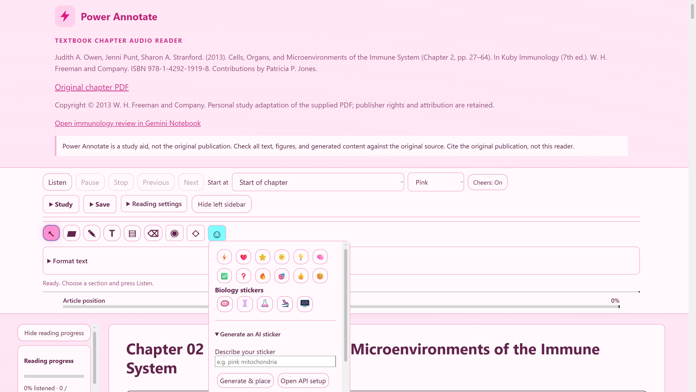
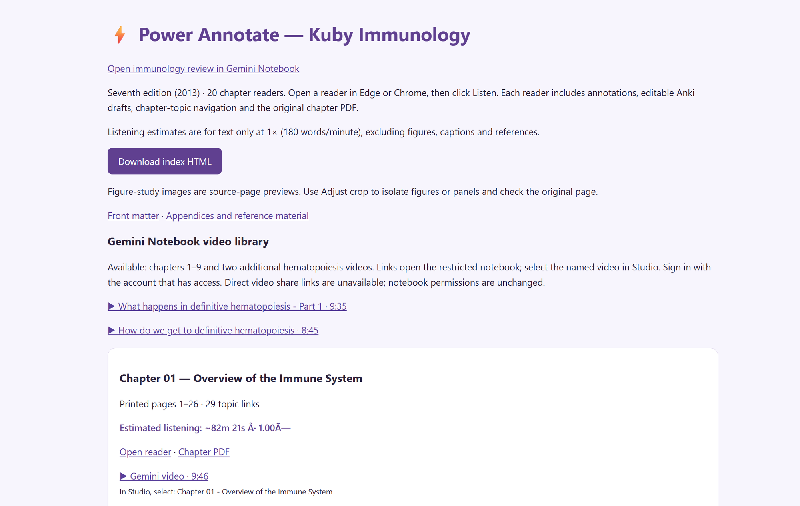
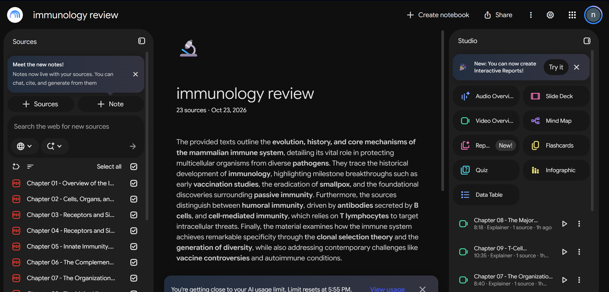

# textbook_PDF_splitter_and_organizer

A Codex skill (`textbook-notebook-videos`) that turns a bookmarked textbook PDF into a study batch: one PDF per chapter, a ready-to-paste video prompt per chapter, a manifest, and a local index page. The full workflow also covers optional Power Annotate readers and generating Explainer videos in a Gemini Notebook / NotebookLM notebook.

## What it does

- Splits a textbook PDF into chapter PDFs using its top-level bookmarks. Extraction uses physical PDF page ranges, not assumed printed page offsets. The original PDF is never modified (its SHA-256 is checked before and after).
- Generates one video prompt file per chapter from an adaptable template.
- Writes `manifest.json` (chapters, page counts, prompts, opening-page text, per-chapter status) and a `Start Here.html` index linking each chapter PDF and video prompt.
- Optionally builds a Power Annotate reader for each chapter and adds an "Open Power Annotate reader" link to the index (workflow step in `SKILL.md`; not done by the script).
- Drives the notebook workflow: upload the chapter PDFs, create an **Explainer** video per chapter (English, Kawaii, Custom topic, chapter-specific prompt), handle quota limits, and rename finished videos after their source.

The skill respects narrow requests: upload-only, videos-only, or rename-only requests stay narrow. A rename-only request does not authorize generating videos or rebuilding readers.

## Screenshots

**Power Annotate chapter reader** (audio playback, annotation tools, stickers)



**Start Here index** (per-chapter reader, PDF, and video links)



**Notebook with chapter PDFs as sources and Explainer videos in Studio**



## Requirements

- Python 3 with [PyMuPDF](https://pymupdf.readthedocs.io/) (`pip install pymupdf`), imported as `pymupdf`.
- A textbook PDF with reliable numbered top-level bookmarks (for example `1 Title`, `2 Title`, ...).
- The `power_annotate` skill, for the reader step. If it is missing, the PDFs, prompts, and index are still prepared and readers are marked unavailable.
- Browser automation, to operate the NotebookLM / Gemini Notebook UI.
- A signed-in notebook, and its URL.

At the start of a full workflow the skill prints: **install power annotate to have full capability of the skill**.

## Repo layout

```
SKILL.md                    Skill instructions and workflow rules
scripts/prepare_chapters.py Chapter splitter, prompt generator, manifest and index writer
assets/video_prompt.txt     Video prompt template (filled per chapter)
```

## Usage

```
python scripts/prepare_chapters.py \
  --source "C:\books\textbook.pdf" \
  --output "C:\books\textbook_batch" \
  --book "Book Title" \
  --edition "5th edition" \
  --authors "Author One, Author Two" \
  --year 2020 \
  --notebook "https://notebooklm.google.com/notebook/..."
```

| Argument | Required | Description |
|---|---|---|
| `--source` | yes | Path to the bookmarked textbook PDF |
| `--output` | yes | Output folder (created if needed) |
| `--book` | yes | Book title |
| `--edition` | yes | Edition label |
| `--authors` | yes | Authors, also written to chapter PDF metadata |
| `--year` | yes | Publication year |
| `--notebook` | yes | Notebook URL, linked from the index and stored in the manifest |
| `--research-lens` | no | Text for the prompt's "Research bridges" section. Default: "Relate supported chapter concepts to cell identity, gene regulation and experimental reasoning; do not invent external paper findings." |
| `--prompt-template` | no | Custom template path. Default: `assets/video_prompt.txt` |

Template placeholders: `{number}`, `{title}`, `{filename}`, `{book}`, `{edition}`, `{authors}`, `{year}`, `{research_lens}`.

Output:

```
<output>/
  manifest.json
  Start Here.html
  Chapter 01/
    Chapter 01 - <title>.pdf
    Chapter 01 - Video Prompt.txt
  Chapter 02/
  ...
```

Behavior and safeguards:

- Exits without overwriting if `<output>/manifest.json` already exists. Inspect and resume the existing batch instead.
- Exits if chapter bookmarks are absent or not consecutive from 1. Derive a reviewed manifest manually in that case; do not substitute a subsection for a chapter.
- Subsection bookmarks are carried into each chapter PDF.
- Asserts each chapter PDF's page count and that its first and last pages render identically to the source.
- Every chapter starts with status `not-submitted`, format `Explainer`, style `Kawaii`.
- Review the discovered boundaries and opening-page text before uploading anywhere.

## Prompt length cap (5000 characters)

The script stops if any filled prompt exceeds 5000 characters, because the notebook's Custom topic box has a character limit. Shorten the template or research lens, or adapt the prompt for that chapter. The skill says to check the actual textbox limit in the UI and never silently truncate instructions.

## Template caveat: biology-tuned defaults

`assets/video_prompt.txt` and the default `--research-lens` are written for a biology graduate student strong in molecular/cell biology and single-cell analysis who is learning developmental biology. The template references developmental processes (induction, patterning, fate mapping, lineage tracing, and so on) and the default lens mentions cell identity and gene regulation. For another discipline, edit the template and pass your own `--research-lens` (or `--prompt-template`) before generating prompts. The template also requires source grounding: use only the selected PDF, cite pages, avoid outside knowledge, and mark extrapolations.

## Workflow stages

1. **Verify the book.** Check title page, edition, year, and chapter boundaries against bookmarks and opening pages. Skip front matter, glossary, and index unless requested.
2. **Prepare.** Run `prepare_chapters.py`, then review the manifest and boundaries.
3. **Readers (optional).** With `power_annotate` installed, build a reader per chapter beside its PDF, validate each, and add reader links to `Start Here.html`. The original chapter PDF is kept unchanged.
4. **Upload.** Check existing notebook sources and artifacts first to avoid duplicates, upload only authorized files, and verify imports finish.
5. **Generate.** For each chapter, select exactly its matching PDF, choose **Explainer** (not Short/Brief), English, Kawaii, Custom topic, and paste the adapted prompt.
6. **Quota handling.** If quota is exhausted, use **Generate later** when available (a scheduled item is not a finished video). Once generation controls are disabled, stop submitting, save remaining prompts and status, and report the reset time shown in the UI. Do not buy upgrades, bypass limits, use alternate accounts, or fall back to Short. A failed video gets one visible Retry.
7. **Track status.** Keep the manifest updated per chapter (not-submitted, submitted, scheduled, generating, completed, failed) and inspect notebook state before resuming.
8. **Rename by source.** For finished videos, open **More, View prompt and sources** to confirm the source, then **More, Rename** to the source stem without `.pdf`, for example `Chapter 07 - The Organization and Expression of Lymphocyte Receptor Genes`. Verify title and source after saving. Scheduled or generating entries may not offer Rename; defer them.
9. **Report.** Save a screenshot of the video list and a status record. Report separate counts for finished, generating, scheduled, and unsubmitted chapters. A prompt file is preparation, not a video.
